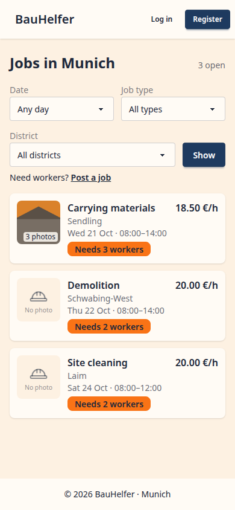
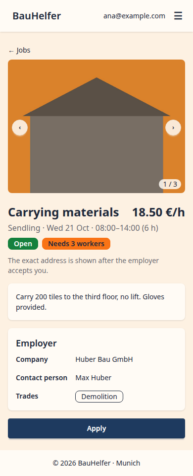
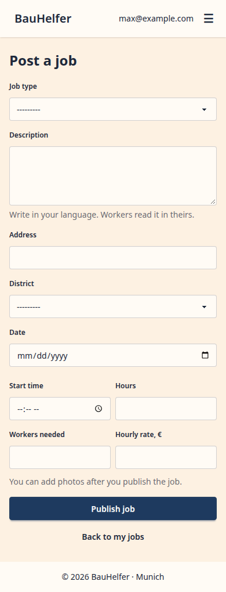
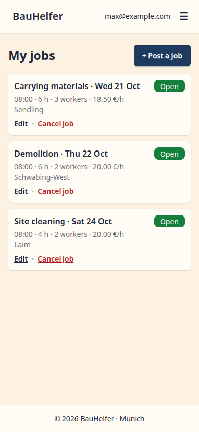

# UI mockups

Phone screens (390 × 844) of the finished BauHelfer as planned in M3, drawn with AI during #15
and saved here in #122. They are **frozen**: they show the plan, not the app. Where a ticket
decides differently, the spec says so, and the screen stays as it is. In M8 the defense shows
them next to screenshots of the real app: planned → built.

Screens are drawn at 390 px (iPhone 12–14); the app itself is checked at 360 px, the project's
phone width (a small Android phone, `docs/TESTING.md`).

Before writing the spec of a ticket, find its screens below and compare: every difference
(a field, a label, a layout) becomes a decision in the spec, not a fix after the merge.

Details on a screen that are in no ticket yet (for example the distance on job cards or the
"2 / 3 workers found" bar) are proposals: the ticket decides whether they become features.

Each screen is shown 180 px wide; click it to see it full size.

The **Built** row shows the real app: one screenshot per screen in `built/`, 390 px wide, light
theme, full page, test data only. A ticket that changes a screen overwrites its file, so
`git log -- docs/mockups/built/<screen>.png` shows how the screen grew (decided in #19).
`uv run pytest tests/e2e/built_screenshots.py` takes them again with made-up data.

## Worker: find a job, apply, get accepted

| Jobs list + filters | Job detail + apply | Map, near me | My applications |
| --- | --- | --- | --- |
|  |  |  |  |
| #18 | #19, #22, #32, #64 | #41, #42 | #25, #26 |
| **Built:**  |  | not built yet | not built yet |

## Employer: post a job, pick workers, chat, review

| Post a job | My jobs + applications | Chat, dark mode | Worker profile + review |
| --- | --- | --- | --- |
|  |  |  |  |
| #16, #17, #64 | #20, #23, #24 | #35, #36 | #38, #39 |
| **Built:**  |  | not built yet | not built yet |

## Decided differently

| Screen | Mockup | App | Decided in |
| --- | --- | --- | --- |
| Post a job | "From · To" | start time + hours | #15 (`docs/specs/job.md` D2) |
| Post a job | district found on the map | district drop-down until geocoding (#41) | #16 |
| Post a job | rate "12,00" with a comma | a dot until the translations (M5) | #16 |
| Post a job | photo tiles in the form | photos are added on the job's edit page, which opens after "Publish" at `#photos`; the form says so | #64 (D10, D13, D21) |
| Post a job | an "Add" tile with a camera | a file field (several files) and an "Add photos" button | #64 (D14) |
| Jobs list | district · date · time on one line | district on its own line (cut with "…"), date and time below | #18 (D8) |
| Jobs list | "This week" | "Next 7 days" / "Next 30 days", counted from today | #18 (D12) |
| Jobs list | filters change the list at once | a "Show" button next to the district, the page reloads | #18 (D9, D11) |
| Jobs list | phone only | on laptops (from 1024 px) the filters are a column on the left | #18 (D13) |
| Jobs list | "No photo" tile | a hard-hat icon with "No photo" | #64 (D26) |
| Job detail | "1 of 3 workers found" | "Needs 3 workers" until accepting exists | #19 (#24) |
| Job detail | "Translated by AI" | not shown until the translations | #19 (#32) |
| Job detail | the employer's rating | not shown until the reviews | #19 (#39) |
| Job detail | "Apply" opens the form | "Apply" posts to a stub until #22 | #19 (D3) |
| Job detail | a big photo box | without photos a low strip instead | #19 (D11) |
| Job detail | phone only | the photo is 16 : 9 on a laptop | #19 (D11) |
