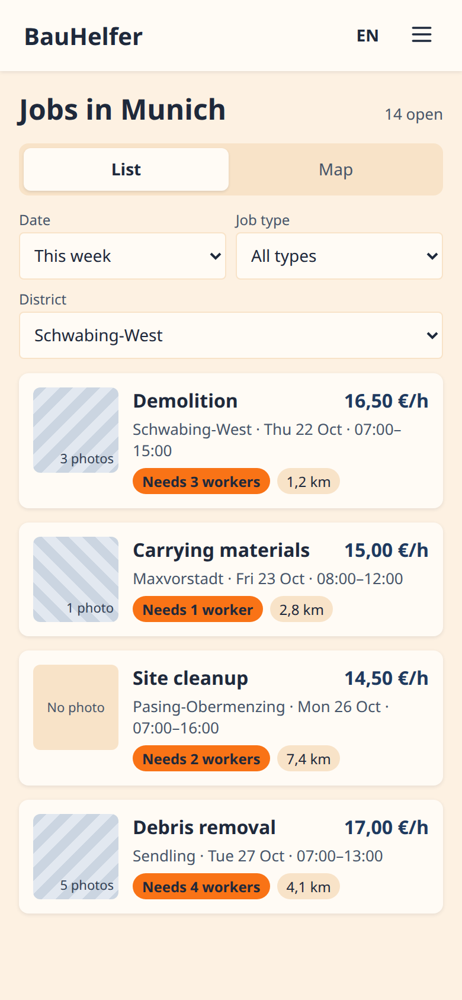
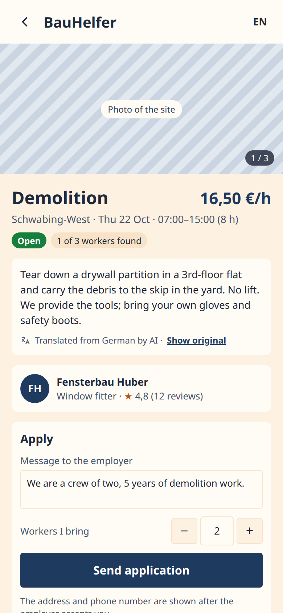
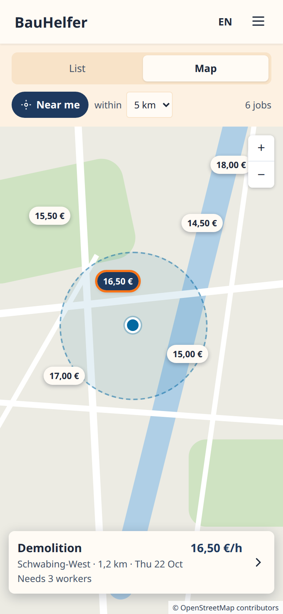
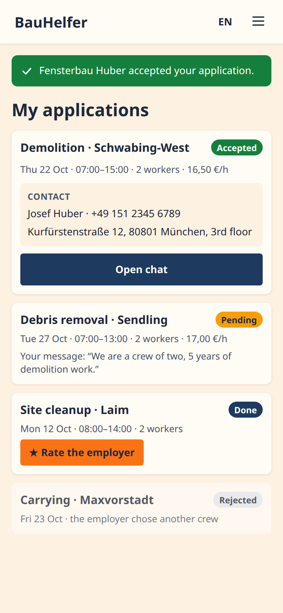
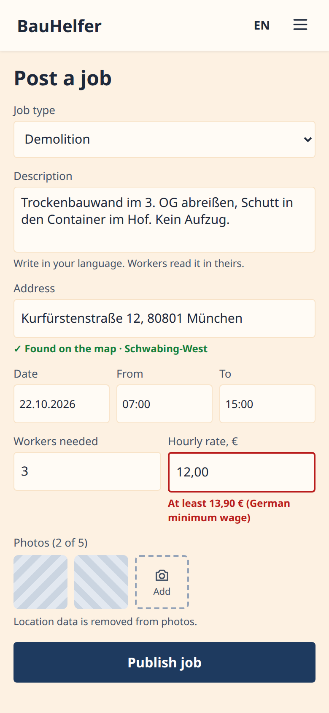
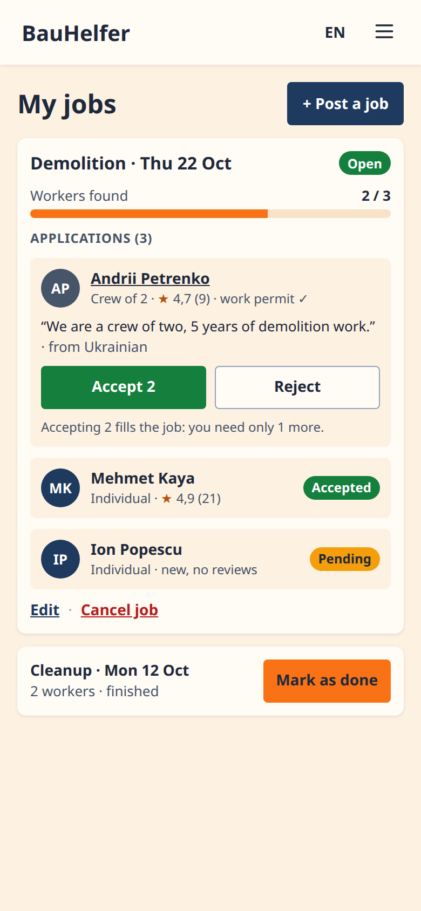
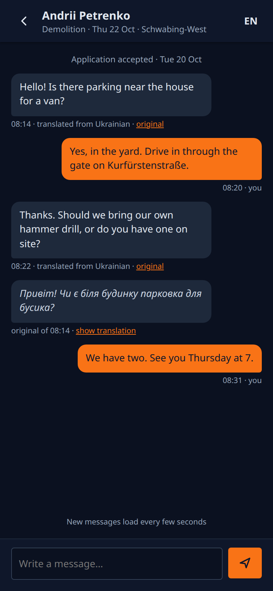
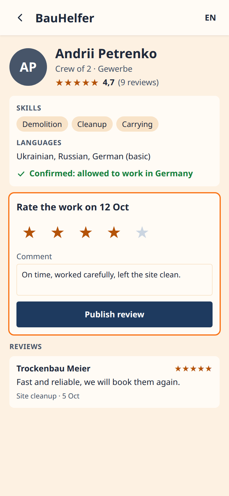

# UI mockups

Phone screens (390 × 844) of the finished BauHelfer as planned in M3, drawn with AI during #15
and saved here in #122. They are **frozen**: they show the plan, not the app. Where a ticket
decides differently, the spec says so, and the screen stays as it is. In M8 the defense shows
them next to screenshots of the real app: planned → built.

Screens are drawn at 390 px (iPhone 12–14); the app itself is checked at 360 px, the project's
phone width (a small Android phone, `docs/TESTING.md`).

Before writing the spec of a ticket, find its screens below and compare: every difference
(a field, a label, a layout) becomes a decision in the spec, not a fix after the merge.

Details on a screen that are in no ticket yet (for example the distance on job cards or the
"2 / 3 workers found" bar) are proposals: the ticket decides whether they become features.

## Worker: find a job, apply, get accepted

| Screen | Tickets |
| --- | --- |
| Jobs list + filters | #18 |
| Job detail + apply | #19, #22, #32, #64 |
| Map, near me | #41, #42 |
| My applications | #25, #26 |

## Employer: post a job, pick workers, chat, review

| Screen | Tickets |
| --- | --- |
| Post a job | #16, #17, #64 |
| My jobs + applications | #20, #23, #24 |
| Chat, dark mode | #35, #36 |
| Worker profile + review | #38, #39 |

## Decided differently

| Screen | Mockup | App | Decided in |
| --- | --- | --- | --- |
| Post a job | "From · To" | start time + hours | #15 (`docs/specs/job.md` D2) |
| Post a job | district found on the map | district drop-down until geocoding (#41) | #16 |
| Post a job | rate "12,00" with a comma | a dot until the translations (M5) | #16 |
