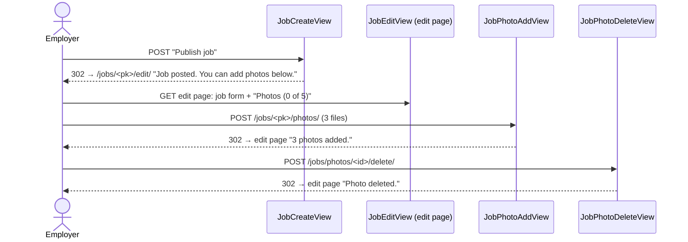

# Spec: job photos (#64)

Status: **iteration 1 agreed and built; iteration 2 draft**. D1 and D2 decided by the
student on 2026-10-16; the iteration 1 defaults (D3–D9) accepted by the student the same day,
before any tests. Iteration 2: D10–D13 decided by the student on 2026-10-17; defaults
D14–D19 accepted by the student the same day, before any tests.

## Goal

Employers attach up to 5 photos to a job, so workers see the scope of the work (amount of
debris, floor, access) before they apply. Photos are personal data more often than it seems:
a phone photo carries the GPS position of the place where it was taken, so the location is
removed before a photo is stored.

The ticket comes in four iterations, each with its own failing tests → code → integration
tests:

1. **Photo model and processing:** `JobPhoto`, checking a file, resizing, removing EXIF,
   storing locally in `media/`. Visible in the admin only.
2. **Upload and delete on the job's edit page** (employer).
3. **Thumbnail on the job list.**
4. **Production storage:** Supabase Storage.

## Decisions taken before the spec (student, 2026-10-16)

D1. **The job detail page is not built here; showing photos on it moves to #19.** The
    ticket's "Photos shown on the job detail page" assumed #19 was done; it is not. The
    student's criterion: "first the photo support, the page comes later". #19 gets a
    "Done when" line for the photos (drafted at the end of this ticket, posted after "yes").
    Rejected: building a small detail page here (it is #19's work, and #19 decides who sees
    the address). **Revisit when** #19 starts: the photos go on its page.
D2. **Production photos go to Supabase Storage, not Cloudflare R2.** The student checked R2:
    it needs a payment card even for the free tier, and the project runs on free tiers with
    no card. Supabase is free without a card, the project already has a Supabase account
    (the database, Frankfurt), so the data stays in the EU in a place that is already listed.
    Both speak the S3 protocol, so the same `django-storages` S3 backend and `boto3` (already
    approved) serve either; moving to R2 later means new env values, one line for the public
    address and copying the files (the database stores only the path, `job_photos/….jpg`).
    Free limit: 1 GB or 500 MB (sources disagree, iteration 4 checks); a photo after
    resizing is about 200–400 KB, so hundreds of jobs fit. Rejected: R2 (card), Backblaze B2
    (one more account, the EU region must be chosen at sign-up and cannot change).
    **Revisit when** photos need more than the free limit, or Supabase pauses the project in
    a way that hurts the demo. This changes the ticket's "Production uses R2" and
    `docs/PLAN.md` (comment for Docs sync — M3).

## Iteration 1: photo model and processing

### Requirements

R1. New dependency `Pillow` (approved in the ticket). Django's `ImageField` needs it.
R2. Model `JobPhoto` in `jobs/models.py`: `job` (FK to `Job`, `on_delete=CASCADE`,
    `related_name="photos"`), `image` (`ImageField`), `uploaded_at` (`auto_now_add`).
    Ordered by `uploaded_at`, then `id` (the first photo is the one the list shows, #3).
R3. `Job.MAX_PHOTOS = 5`, the one place for the limit (D6).
R4. One function checks and prepares an uploaded file: `prepare_photo(file)` in a new
    `jobs/photos.py`. It raises `ValidationError` with a message for the user, or returns a
    new file ready to store (D3). It checks, in this order:
    - size at most 5 MB, before the file is opened (an error names the limit);
    - Pillow can open it and its **real format** (read from the content, not from the file
      name or the type the browser sends) is JPEG, PNG or WebP (D4);
    - not more than Pillow's pixel limit (about 89 megapixels): a small file that unpacks to a
      gigantic picture ("decompression bomb") is refused, not opened.
R5. `prepare_photo` then:
    - turns the picture upright using its EXIF orientation (`ImageOps.exif_transpose`):
      phones save a portrait photo lying on its side plus a "rotate me" note in EXIF, so
      without this step removing EXIF would leave portrait photos sideways;
    - shrinks it to at most 1600 px on the long side, keeping the proportions; a smaller
      picture is not enlarged;
    - saves it as JPEG, quality 85, **without any EXIF** (no GPS, no camera, no date) (D5).
R6. The stored file gets a random name, `job_photos/<32 hex characters>.jpg` (D7). The
    original file name is not kept.
R7. When a `JobPhoto` row is deleted — on its own, with its job, or with the employer's
    account (cascade) — its file is deleted from storage too, after the database change is
    committed (D8).
R8. Local development: `MEDIA_ROOT = BASE_DIR / "media"`, `MEDIA_URL = "/media/"`;
    `config/urls.py` serves media files only when `DEBUG` is on (Django's `static()` helper
    does nothing otherwise). `media/` is already in `.gitignore`.
R9. Tests never touch the disk or the network: an autouse fixture in the root `conftest.py`
    switches the default storage to Django's `InMemoryStorage` (like `fast_password_hasher`).
R10. Admin: the job page in `/admin/` shows the job's photos as an inline (add, delete,
     at most `Job.MAX_PHOTOS`); an uploaded file goes through `prepare_photo` too (D9).
R11. Every UI string (error messages, labels) is wrapped in `gettext_lazy`.

### Out of scope (iteration 1)

- The employer's job form: iteration 2. The job list: iteration 3. Supabase: iteration 4.
- The detail page: #19 (D1).
- Recognising faces, number plates or house numbers in a photo: a photo can still show a
  person. Iteration 2 tells the employer what is removed and what is not (limitation for
  `docs/SECURITY.md`).

### Acceptance criteria (→ tests)

AC1. A JPEG, a PNG and a WebP are accepted; each comes back as a JPEG.
AC2. A text file named `photo.jpg`, and a GIF, are refused with an error message.
AC3. A file over 5 MB is refused, and the error names 5 MB.
AC4. A picture over the pixel limit is refused (the limit is lowered in the test, so it does
     not need a huge file).
AC5. A 4000 × 3000 picture comes back 1600 × 1200; a 3000 × 4000 one 1200 × 1600; an
     800 × 600 one stays 800 × 600.
AC6. A JPEG with GPS and camera EXIF comes back with no EXIF at all.
AC7. A photo stored on its side with EXIF orientation "rotate 90°" comes back upright
     (width and height swapped) and without EXIF.
AC8. The stored name matches `job_photos/<32 hex>.jpg`; the original name does not appear.
AC9. Deleting a photo, deleting its job, and deleting the employer each remove the file
     from storage.
AC10. `job.photos.all()` returns the photos oldest first.
AC11. In the admin, a job page with 5 photos does not offer a 6th; an uploaded photo there
      has no EXIF.

### Defaults for iteration 1 (object to any line)

Small choices with a default, per the rule from #18. Each has "Revisit when".

| | Default | Why | Rejected | Revisit when |
|---|---|---|---|---|
| D3 | All checks and processing in **one function**, `prepare_photo`, called by every form that takes a photo (admin now, job form in iteration 2) | Unit tests need no database and no view; one place to read at the defense | Processing in `JobPhoto.save()` (runs again on every save; errors there are not form errors) | a third place uploads photos |
| D4 | The format is read **from the content** by Pillow | A file name and the browser's type are typed by the sender and can lie | Checking the extension or `content_type` | — |
| D5 | Everything is stored as **JPEG, quality 85** | One format every browser and mail client shows; PNG screenshots shrink a lot | WebP (about 30 % smaller, but not every old tool opens it); keeping the original format | the free storage limit gets close: switch to WebP |
| D6 | The limit of 5 is checked **in forms** (admin inline, job form), not in the database | A database rule "at most 5 rows per job" needs a trigger; two uploads at the same second are not a real risk here | A database trigger | photos come from somewhere other than a form (an API) |
| D7 | Random file name | The original name can hold a person's name ("Familie_Maier_Bad.jpg") and two files with the same name would clash | `upload_to="job_photos/"` with the original name | — |
| D8 | Files are deleted by a **`post_delete` signal**, after commit (`transaction.on_commit`) | Django never deletes a file when its row goes, and a `delete()` method on the model is **not called** for a cascade or a queryset delete; the signal is. After commit, so a rolled-back delete does not lose the file | Overriding `JobPhoto.delete()`; a cleanup command (needs cron, paid on Render) | a job "delete" button for employers appears (today they only cancel; deletion is admin or account deletion) |
| D9 | Photos also in the **admin** | Iteration 1 can be tried in the browser before the job form exists; staff can remove a bad photo | Admin without photos | — |

the stored 1600 px photos **shrunk by CSS** | At most 5 on one page, so the size does not matter here; the list (iteration 3) is where it does | Small copies just for this page | — |
| D16 | With 5 photos the upload form **disappears**, a line says it is the maximum | The employer sees at once why nothing can be added | A disabled field | — |
| D17 | **All or nothing**: one bad file, none of the batch is saved | One clear message, nothing half done, simple code | Saving the good ones and reporting the bad one (two kinds of result to show) | employers often mix good and bad files |
| D18 | Errors come back as a **message after a redirect**, not as form errors on a re-rendered page | The add view would otherwise have to rebuild the whole edit page with the job form; a redirect reuses it. The photo form has one field, so there is nothing to keep | Re-rendering the edit page from the add view | the photo form gets more fields (captions) |
| D19 | "×" deletes **at once, no "Are you sure?"** | A photo is cheap to add again; one tap on a phone | A `confirm()` in JS, or a confirmation page | photos are deleted by mistake |## Iteration 2: upload and delete on the job's edit page

### How it works for the employer (D10)

1. "Post a job": the form as today, without photos. Above "Publish job" a line says that
   photos can be added after publishing (D13).
2. "Publish job" saves the job and opens **its edit page** (not "My jobs"), with the message
   "Job posted. You can add photos below."
3. The edit page is the job form as today, and under it a block "Photos (2 of 5)": the
   photos with a "×" button each, and a field to choose photos (several at once, D12) with
   an "Add photos" button.
4. Adding or deleting a photo reloads the same edit page with a message. The job's own
   fields are already saved, so nothing typed is lost (except unsaved edits, see D11).

### Requirements

R12. `JobCreateView` redirects to the new job's edit page (`job_edit`), with the message
     "Job posted. You can add photos below." (D10). Today it goes to "My jobs" (#16 R11): that
     test changes.
R13. The "Post a job" page shows, above "Publish job": "You can add photos after you publish
     the job." (D13). The edit page does not.
R14. The edit page shows, under the job form and before "Back to my jobs", a block with the
     heading "Photos (N of 5)" and the job's photos in upload order, each as a small picture
     with a "×" delete button (D15). No photos: "No photos yet."
R15. Under the photos, a separate form (`enctype="multipart/form-data"`, its own `<form>`, not
     inside the job form): one file field that takes several files (`multiple`,
     `accept="image/jpeg,image/png,image/webp"`), the button "Add photos" and the hint
     "Location data is removed from photos." (from the mockup). With 5 photos the form is
     not shown; the text "That is the maximum of 5 photos." is (D16).
R16. `POST /jobs/<pk>/photos/` (`job_photo_add`): only the employer's own **open** job
     (`OwnOpenJobMixin`, like edit and cancel: otherwise 404; guests to login, workers 403).
     `JobPhotosForm` checks every file with `prepare_photo()` and that the photos already
     there plus the new ones are at most `Job.MAX_PHOTOS`.
     - All valid: all are saved, message "N photos added." (singular for 1), redirect to the
       edit page.
     - Any error: **none** is saved (D17); an error message names the file and the reason
       ("plan.gif: Upload a photo in JPEG, PNG or WebP format.") or how many more fit ("You
       can add 2 more photos."); redirect to the edit page (D18).
     - No file chosen: message "Choose at least one photo.", redirect.
     - GET: 405 (only POST).
R17. `POST /jobs/photos/<id>/delete/` (`job_photo_delete`): deletes the photo only if its job
     is the logged-in employer's own open job, otherwise 404. Message "Photo deleted.",
     redirect to the edit page. No confirmation (D19). GET: 405. The file goes by the signal
     of iteration 1.
R18. Unsaved changes (D11): when a field of the job form was changed and the employer leaves
     the page without "Save job" (adding a photo, deleting one, "Back", closing the tab), the
     browser asks whether to leave. A few lines of plain JavaScript in `job_form.html`; saving
     the job form does not ask.
R19. Every UI string is wrapped in `` / `gettext_lazy`; "N photos added." and
     "Photos (N of 5)" with plural forms where the number changes the words.

### Out of scope (iteration 2)

- Choosing photos already on the "Post a job" page (D10). Reordering photos, choosing a
  "main" photo, captions.
- Photos of a job that is not open (cancelled, filled): the edit page is for open jobs only
  (#16 D2), so they cannot be changed; they stay.
- Thumbnails on the job list: iteration 3.

### Acceptance criteria (→ tests)

AC12. "Publish job" redirects to `/jobs/<pk>/edit/` of the new job with "Job posted. You can
      add photos below."
AC13. The create page shows "You can add photos after you publish the job."; the edit page
      does not.
AC14. The edit page of a job with 2 photos shows "Photos (2 of 5)", both pictures and two
      delete forms posting to `job_photo_delete`; the upload form posts to `job_photo_add`
      with `multipart/form-data` and a `multiple` file field.
AC15. With 5 photos the upload form is not on the page and "That is the maximum of 5
      photos." is.
AC16. Posting 3 valid photos saves 3 photos without EXIF and says "3 photos added."
AC17. Posting 2 valid files and 1 GIF saves none and the message names the GIF's file name.
AC18. A job with 4 photos: posting 2 saves none and says "You can add 1 more photo."
AC19. Posting no file: "Choose at least one photo.", nothing saved.
AC20. Add and delete as another employer, or on a cancelled job: 404, nothing changes. As a
      guest: redirect to login; as a worker: 403.
AC21. Delete as the owner: the photo row and its file are gone, "Photo deleted.", redirect to
      the edit page.
AC22. GET on both URLs: 405.
AC23. `JobPhotosForm` unit tests: a list of valid files gives prepared JPEGs; the count check
      counts the photos already there.
AC24. The edit page contains the unsaved-changes script (its behaviour is checked in the M3
      E2E ticket #21, not here: only E2E runs JavaScript).

### Decisions (student, 2026-10-17)

D10. **Photos are added on the job's edit page, after the job is saved; "Publish" opens that
     page** (option C2). Options compared with their cost: A) one `multiple` field in the job
     form (as in the mockup; chosen files are lost when another field has an error, and a
     preview needs JS); B) five file fields (clumsy on a phone); C1) a separate "Photos" page
     after publishing; C2) the same, but the photo block is drawn under the job form on its
     edit page; C3) C2 without a reload, via HTMX (the "Back" problems of #18). The
     student's criteria: simple code, photos are never lost, ease of use; the mockups are
     drafts, small JS is fine, a job may have no photos. C2 needs no new page, only two small
     views that come back to the edit page; the job form and the photo form never share a
     request, so the "files lost on an error" problem cannot happen. The student's own
     idea: "after Save the add-photo part appears below". Rejected: A, B, C1, C3.
     **Revisit when** employers ask for photos on the first screen, or a preview before
     publishing.
D11. **The browser warns about unsaved changes** (option ii). Two forms on one page: an
     employer who edits the description and then adds a photo would lose the edit
     silently. About 5 lines of JS. Rejected: no warning (silent loss); saving the job
     form together with the photos (mixes the two forms again).
D12. **Several photos in one go** (`multiple`). Picking 3 photos once in the phone gallery is
     easier than three times. Costs a small `MultipleFileField` from the Django docs (Django
     has no field for several files). Rejected: one photo per upload.
D13. **A line on "Post a job" that photos come after publishing** (the student's idea), so
     the employer does not look for the photo field in vain.

### Defaults for iteration 2 (object to any line)

| | Default | Why | Rejected | Revisit when |
|---|---|---|---|---|
| D14 | Upload by choosing the files **and pressing "Add photos"**; no auto-upload on choose | Works without JS; the employer sees what was chosen before it goes | `onchange="this.form.submit()"` (one line of JS, one tap less) | employers forget to press the button |
| D15 | The edit page shows 

## Iteration 3: thumbnail on the job list (to decide before its tests)

- The list shows 20 cards: 20 photos of 300 KB is 6 MB on a phone. Store a small copy
  (about 400 px) next to each photo at upload, or let the browser shrink the big one.
- The mockup's "3 photos" on the thumbnail and the "No photo" tile.

## Iteration 4: production storage (to decide before its tests)

- Public bucket (a fixed address per photo, cacheable) or private (a link that expires,
  made by the S3 backend on every page).
- Env variables for `.env.example` and Render; check the current free limit.

## Differences from the mockups

| Screen | Mockup | App | Why |
|---|---|---|---|
| Job detail | big photo with "1 / 3" | not in this ticket | D1, #19 |
| Post a job | "Photos (2 of 5)" with tiles and "Add" | no photos here; a line says they come after publishing; the block is on the edit page | D10, D13 |
| Post a job | "Add" tile with a camera icon | a file field and an "Add photos" button | D14 |
| Jobs list | thumbnail with "3 photos", "No photo" tile | decided in iteration 3 | — |
